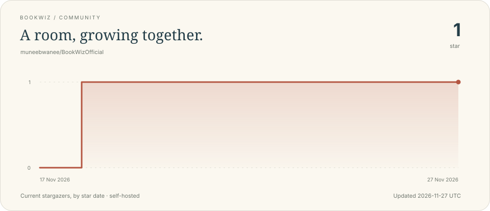

<div align="center">

# A room, growing together

**BookWiz's star-history chart is generated here and hosted here.**

[BookWiz](../README.md) · [Star the repository](https://github.com/muneebwanee/BookWizOfficial/stargazers) · [Contribute](../CONTRIBUTING.md)

</div>

---



The README uses `docs/assets/star-history.svg`, stored in this repository. No external chart service renders or hosts it. `docs/assets/star-history.json` contains the aggregate data used for the image.

## Regenerate the chart

Install [GitHub CLI](https://cli.github.com/), then authenticate once:

```sh
gh auth login
python3 scripts/gen_star_history.py
```

The generator uses Python's standard library and GitHub CLI. It requests every page of timestamped stargazers, validates the response, groups stars by UTC date, and writes the SVG and aggregate JSON. It does not store usernames or user IDs in the generated files. An authenticated `GH_TOKEN` can be used instead of interactive login in automation.

The SVG and JSON are committed with the source. Normal contributor checks use those files without contacting GitHub. The initial source-import workflow generates them before validating documentation or packaging the platform archives.

To check every local documentation link and image reference:

```sh
python3 scripts/check_docs.py
```

The check includes the README, contributor guides, platform notes, and gallery. It reports missing local targets without fetching external links.

## Daily refresh

`.github/workflows/star-history.yml` runs each day at **06:17 UTC** and can also be started with **Actions → Star history → Run workflow**. It regenerates the chart with the repository's `GITHUB_TOKEN`, then commits only the chart and its aggregate JSON to the default branch when they change. GitHub may delay scheduled runs. Branch rules that prohibit direct bot commits also apply to this workflow.

The workflow uses a concurrency group and checks out the default branch even for a manual run. Its commit step refuses to overwrite a newer change to the same generated files. It does not modify source ZIPs, screenshots, videos, tags, or releases.

## What the line represents

The line shows **current stargazers grouped by their recorded star dates**. A repository with no stars displays an honest empty state. Someone who later removes their star is no longer present in GitHub's current stargazer list, so the chart is not a complete historical record of stars that have since been removed.

Counts are checked against GitHub's repository metadata. If the list changes during pagination or GitHub returns incomplete data, the generator retries and then leaves the previous chart in place if it still cannot obtain a consistent snapshot.

---

The generator is **BWNCL** code. This guide, the generated SVG, and its aggregate data are **CC BY 4.0**. [Licensing details →](LICENSING.md)
