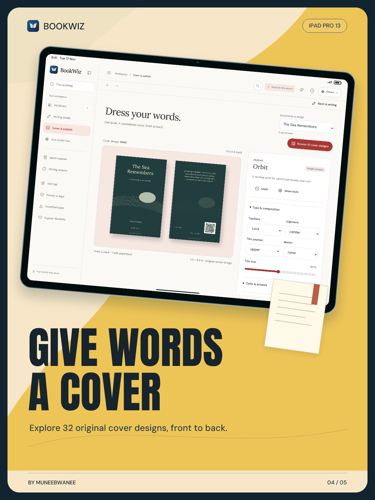
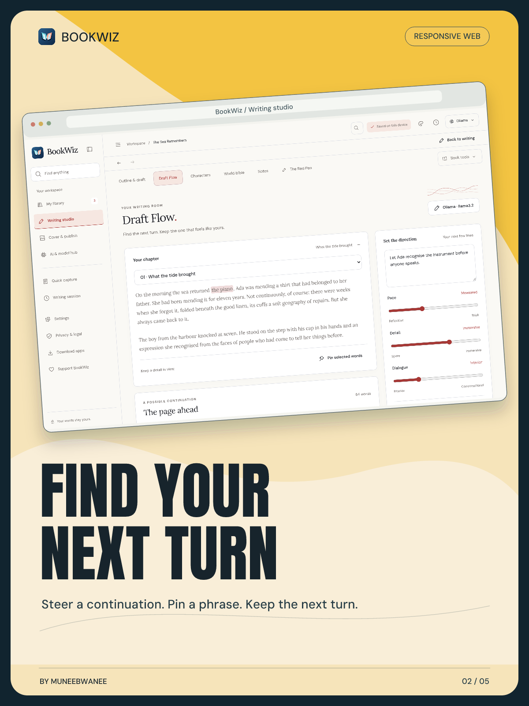
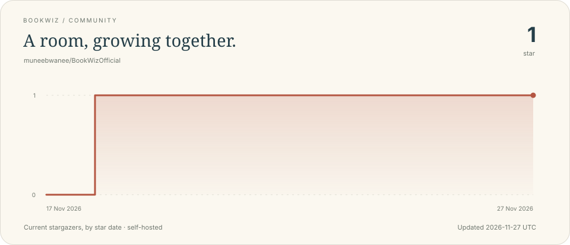

<div align="center">


# BookWiz

### Make room for your next book.

A private writing studio for the idea, the manuscript, and the finished pages.<br>
Created by **[muneebwanee](https://github.com/muneebwanee)**.

[](https://github.com/muneebwanee/BookWizOfficial/stargazers)
[](../LICENSE)
[](../LICENSES/CC-BY-4.0.txt)

**[Get BookWiz](https://github.com/muneebwanee/BookWizOfficial/releases/latest)** · [Explore the gallery](https://github.com/muneebwanee/BookWizOfficial/blob/HEAD/screenshots/README.md) · [Your first book](GETTING_STARTED.md) · [Preview studio](PREVIEW_STUDIO.md) · [Agent skill](AGENT_SKILL.md) · [Support the project](../SUPPORT.md#support-the-project)

</div>

---

I built **BookWiz** to keep the whole life of a book in one thoughtful place: an uncertain idea, a cast that starts to feel real, the difficult middle, the careful revision, and the pages ready for a reader.

Your library lives on your device. Start writing without an account, keep your tools close, and connect a model of your choice when you want another perspective. There is no BookWiz cloud library, public feed, or application telemetry.

<div align="center">

  <h2>BookWiz in motion</h2>

https://github.com/user-attachments/assets/76da7785-d02f-4031-969a-5ec14177726c

  
</div>

## A closer look

<p align="center">
  <a href="https://github.com/muneebwanee/BookWizOfficial/blob/HEAD/screenshots/README.md#android"></a>
  <a href="https://github.com/muneebwanee/BookWizOfficial/blob/HEAD/screenshots/README.md#ipad"></a>
  <a href="https://github.com/muneebwanee/BookWizOfficial/blob/HEAD/screenshots/README.md#web"></a>
</p>

**Nine device galleries. Five images each.** Explore the studio in carefully proportioned phone, tablet and laptop illustrations, with separate companion previews for Apple Watch and Apple TV. The [showcase notes](SHOWCASE.md) identify the hardware and how each image was made.

[Open the complete showcase →](https://github.com/muneebwanee/BookWizOfficial/blob/HEAD/screenshots/README.md)

## From the first note to the final page

| Make space for… | Inside BookWiz |
| :--- | :--- |
| **The idea** | Shape a brief around your language, genre, voice, references, length and chapter outline. |
| **The manuscript** | Rich chapter editing, live word counts, focus mode, search, find and replace, undo/redo and saved versions. |
| **The next turn** | [Draft Flow](DRAFT_FLOW.md): streamed continuation previews, story pins, live steering, a playhead and saved alternatives. |
| **The story** | Character sheets, named worlds, continuity notes and quick captures, kept with their book. |
| **The revision** | The Red Pen for close reading and optional model suggestions you can review before accepting. |
| **The object** | 32 cover directions, typography controls, page proofs, EPUB, Markdown, JSON, print/PDF and LaTeX source. |
| **The habit** | Writing sessions, word goals, read-aloud, theme choices, and widgets and reminders on supported mobile apps. |

Three original reading samples are included. Read them, edit them, or clear a space for your own work.

## See the room before you settle in

**Preview studio** opens a separate window inside BookWiz. Inspect the real library, writing editor, Draft Flow, covers, proofs, model hub and settings at phone, tablet and desktop sizes. Switch between ten palettes and five control styles, inspect the refined brand assets and play the short motion studies. Its sample library uses separate memory storage; your books and saved connections stay in the writing room.

[Open the preview guide →](PREVIEW_STUDIO.md) · [Identity and artwork →](BRAND.md)

## Bring BookWiz to your agent

The self-contained **BookWiz agent bundle** carries the writing workflow into Claude Code, OpenCode, OpenAI Codex CLI, Hermes, Google Antigravity and other Agent Skills hosts. It includes original writing and revision guidance, editable planning templates, a local project tool, snapshots, EPUB/Markdown/backup exports, host installers and plugin manifests. Python's standard library is enough for its offline tools.

[Install the skill or plugin →](AGENT_SKILL.md)

## Choose your edition

All official application downloads are in **[GitHub Releases](https://github.com/muneebwanee/BookWizOfficial/releases/latest)**. The [download guide](RELEASE.md) explains the package for each device.

| Edition | Package | Made for |
| :--- | :--- | :--- |
| **Windows** | One `Windows-Setup.exe` | An installer that selects x64 or ARM64 for your computer. |
| **macOS** | One `macOS.dmg` | A universal application for Intel and Apple Silicon. |
| **Linux** | `.AppImage` or `.deb` | Your preferred x64 desktop package. |
| **Android** | `.apk` | Phone and tablet installation; `.aab` is the separate store bundle. |
| **iPhone & iPad** | `.ipa`, when available | An Apple package signed and provisioned for its installation channel. |
| **Apple Watch** | Companion in the iPhone app | Catch a thought and check your writing progress. |
| **Apple TV** | A tvOS `.ipa`, when available | Read, listen, review an outline, and bring a book over locally. |
| **Web** | Web release or source | A responsive browser studio, with offline application assets after caching. |
| **Agents** | `Agent-bundle.zip` | One self-contained skill/plugin bundle, with host-aware installation and offline writing tools. |

[Platform features →](PLATFORMS.md) · [Source editions →](SOURCE_ARCHIVES.md)

## Begin with one good page

1. **Make a book.** Choose its brief or import a BookWiz JSON backup.
2. **Give it a world.** Keep the premise, characters, places and chapter plan within reach.
3. **Write and return.** Work by hand, use a focused session, or approve an optional model request.
4. **Make an independent copy.** Proof the pages and export the format your next step needs.

**⌘/Ctrl K** searches your workspace. **⌘/Ctrl Shift F** opens focus mode. **Back to writing** returns to the working chapter.

## Your words stay yours

> Your original books belong to you. BookWiz takes no ownership or royalty in your manuscripts or original work. The software's non-commercial license is separate from your right to publish and sell your books.

Books, preferences and notes stay in local storage. API keys stay in memory unless you choose passphrase-protected encrypted storage. Backups exclude those keys. Each browser or app has its own library; **JSON backups** move your work between them.

Model connections are optional. The hub supports hosted providers and compatible endpoints, and detects running Ollama, LM Studio and llama.cpp services without sending manuscript text. Supported iPhone/iPad devices can use Apple Intelligence when its device model is available. Provider access, billing and language support vary.

[Privacy and data flow →](../PRIVACY.md) · [Connections and local models →](PROVIDERS.md)

## Explore, contribute, make it better

BookWiz is created and maintained by **[muneebwanee](https://github.com/muneebwanee)**. I welcome thoughtful bug reports, accessibility improvements, translations and focused contributions that make the room better for writers.

<p>
  <a href="https://github.com/muneebwanee"></a>
</p>

**[Meet the contributors](https://github.com/muneebwanee/BookWizOfficial/graphs/contributors)** · [Contribution guide](../CONTRIBUTING.md) · [Report a problem](https://github.com/muneebwanee/BookWizOfficial/issues/new)

The full source for every platform lives in this repository. The browser studio uses JavaScript modules and locally bundled assets; `native/android/`, `native/apple/`, and `native/desktop/` contain the platform hosts. Clone once and contribute directly. The platform ZIPs remain available as distribution snapshots.

```sh
git clone https://github.com/muneebwanee/BookWizOfficial.git
cd BookWizOfficial
npm ci --ignore-scripts
npm run check
npm test
python3 -m http.server 4173 --directory dist --bind 127.0.0.1
```

Open **http://localhost:4173**. [Build and test the source →](BUILDING.md)

## Cite BookWiz

For a report, course or research project, use the repository’s [citation metadata](../CITATION.cff). GitHub’s **Cite this repository** action provides formatted citations for BookWiz by **muneebwanee**.

<!-- bookwiz-contributor-source:start -->
## Star history



This chart is **self-hosted**. Regenerate it with `python3 scripts/gen_star_history.py` after `gh auth login`. It refreshes automatically each day via `.github/workflows/star-history.yml`. [How the chart works →](STAR_HISTORY.md)

## Code and content licenses

**`*.py`, `*.sh`, and other source files: BWNCL.** **`*.md` documentation, wordlists, regex catalogs, and rubrics: CC BY 4.0.** Third-party licenses and notices remain intact. Your original books remain yours.

[Code license](../LICENSES/BWNCL-1.0.txt) · [CC BY 4.0](../LICENSES/CC-BY-4.0.txt) · [Scope and attribution](LICENSING.md)
<!-- bookwiz-contributor-source:end -->

## Keep the room open

If BookWiz earns a place on your desk, your support helps me keep building it. A star, a useful issue or a careful contribution is welcome too.

**[Ko-fi](https://ko-fi.com/muneb)** · **[Buy Me a Coffee](https://www.buymeacoffee.com/muneebwanee)** · **[Liberapay](https://liberapay.com/muneeb/donate)** · **[Saweria](https://saweria.co/muneeb)**

**Bitcoin** · [Open in a wallet](bitcoin:36QW21MQQxUK7ohBQnvP5itipe4bFx91Bo)

```text
36QW21MQQxUK7ohBQnvP5itipe4bFx91Bo
```

[Support options and project help →](../SUPPORT.md)

---

<div align="center">

**BookWiz · by muneebwanee**

[Getting started](GETTING_STARTED.md) · [Design](../DESIGN.md) · [Changelog](../CHANGELOG.md) · [Privacy](../PRIVACY.md) · [Terms](../TERMS.md) · [License](../LICENSE)

[Star BookWiz](https://github.com/muneebwanee/BookWizOfficial/stargazers) · [Fork the repository](https://github.com/muneebwanee/BookWizOfficial/fork)

</div>
